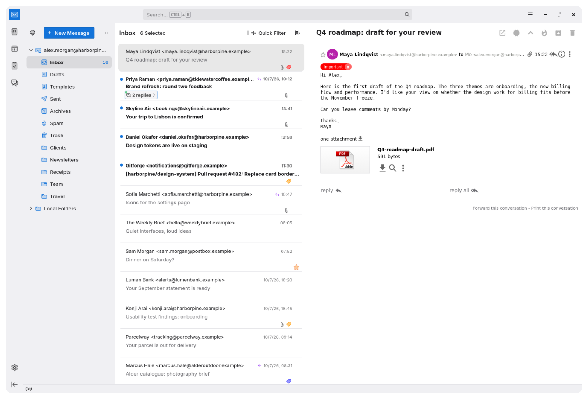
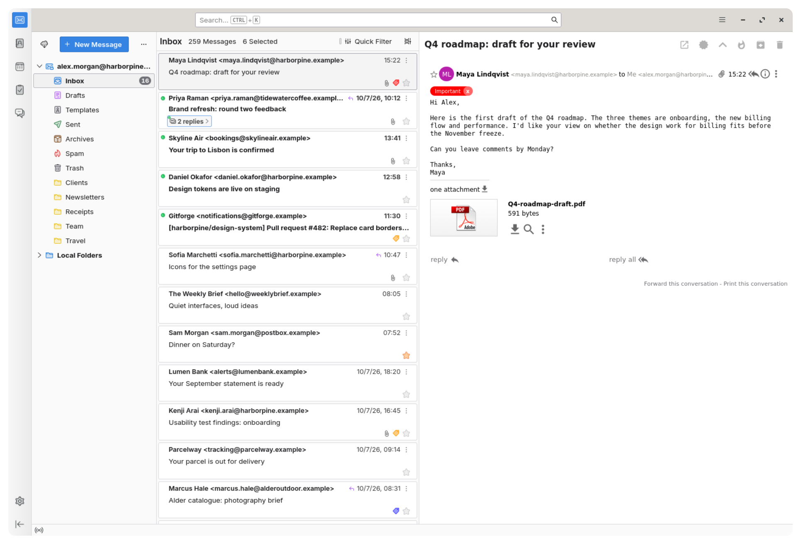
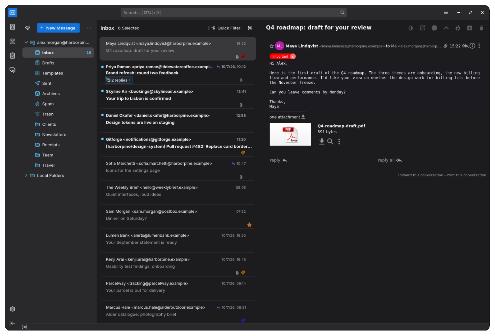
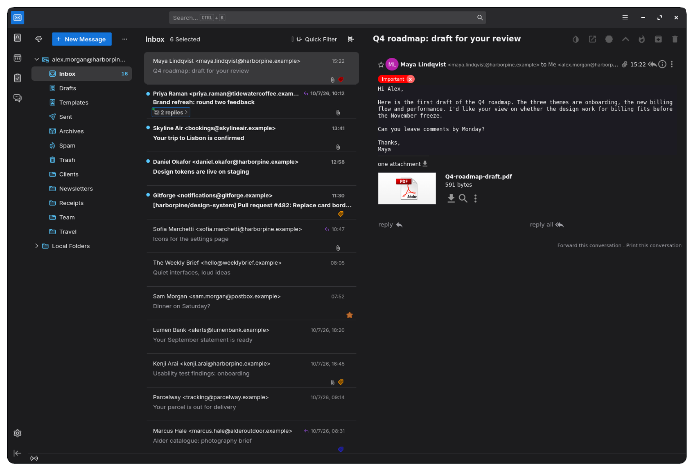

# Clean themes for Thunderbird

Six themes for Thunderbird and Betterbird that take out the boxes, borders and extra shades of gray. What is left is your mail, on two calm surfaces.

| Theme | |
|---|---|
| **Clean Light** | White for mail, a soft gray for the frame, tabs and folder pane |
| **Clean Dark** | Near-black for mail, a lifted dark gray around it |
| **Clean Mono Light** | White everywhere; spacing alone separates the folders from the list |
| **Clean Mono Dark** | One dark surface from edge to edge |
| **Clean Auto** | Clean Light or Clean Dark, following your system's light or dark setting |
| **Clean Mono Auto** | Clean Mono Light or Clean Mono Dark, following your system's setting |

All six use your system's accent colour.

Screenshots, a before-and-after comparison and more details: **https://celest-watches.com/clean-themes/**

## Install

1. Download a theme's `.xpi` file from [Releases](https://github.com/bakatamas/thunderbird-clean-themes/releases). If your browser offers to install it, choose to save it.
2. In Thunderbird, open the menu and choose **Add-ons and Themes**.
3. Click the gear icon, choose **Install Add-on From File**, and pick the file.
4. Under **Themes**, enable it. You can install all six and switch between them there.

To go back, enable one of Thunderbird's built-in themes in the same list.

From version 1.1.7 on, installed themes update themselves like any other add-on. Thunderbird checks once a day, or right away with **Check for Updates** in the gear menu. If you have 1.1.6 or older, install 1.1.7 by hand once.

Requires Thunderbird or Betterbird 153 or later. Made and tested with Betterbird 153 on Linux; Windows and macOS are untested. The themes restyle parts of Thunderbird that can change between releases, so a future update may undo some of the look.

## Thunderbird Conversations

If you use the [Thunderbird Conversations](https://addons.thunderbird.net/thunderbird/addon/gmail-conversation-view/) add-on, a theme cannot reach its reader. The optional stylesheet in [`conversations/`](conversations/) does that part; [its README](conversations/README.md) explains how to install it on Windows, macOS and Linux.

## Screenshots

| | |
|---|---|
|  |  |
| Thunderbird's default | Clean Light |
|  |  |
| Clean Dark | Clean Mono Dark |

The screenshots use a demo mailbox; every person, company and address in them is made up.

## Building

The themes share one stylesheet:

- `src/theme.css` is used by all six themes
- `src/mono.css` is appended to it for the three Mono themes
- `themes/<name>/manifest.json` holds each theme's name, version and colours

`./build.sh` assembles the six `.xpi` files, copies the Conversations stylesheet and makes one zip of everything, all into `dist/`. It needs `sh`, `sed` and `zip`.

For a new version, change `"version"` in all six manifests, update the version line at the top of `conversations/conversations-clean.css` and `conversations/README.md`, add an entry to [CHANGELOG.md](CHANGELOG.md), and run the build.

## Contributing

Issues and pull requests are welcome. Please make stylesheet changes in `src/`, not in the built files.

## Credits

Thanks to [u/KenzieDamage](https://www.reddit.com/user/KenzieDamage/) for the system accent colour, the status bar fix and the tab fix.

## Licence

[Mozilla Public License 2.0](LICENSE). You may use, change and share these files. If you share changed versions of them, keep them under the same licence.

Not affiliated with or endorsed by the Thunderbird or Betterbird projects. Thunderbird is a trademark of the Mozilla Foundation.

Made by Tamás Baka.
